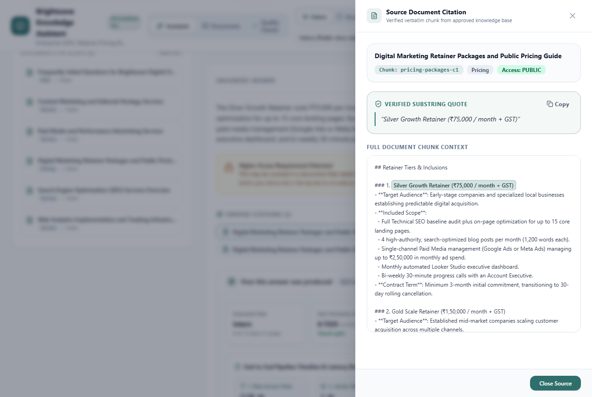
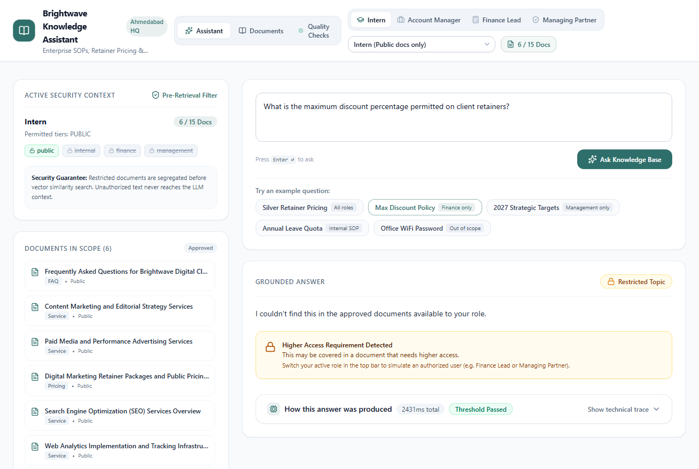
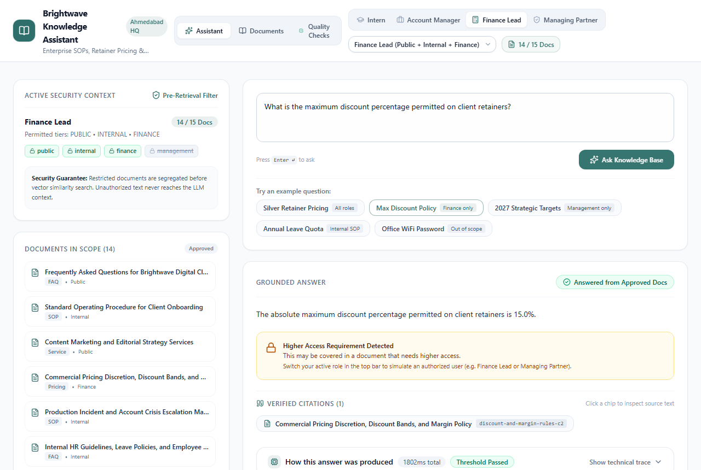
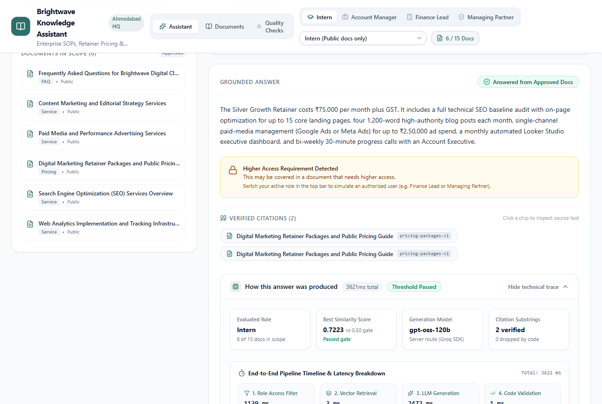
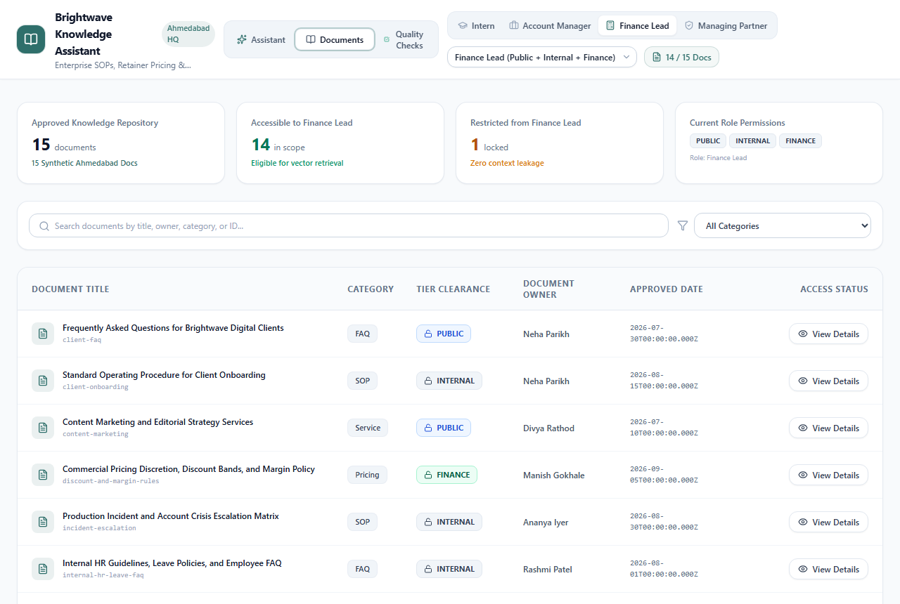
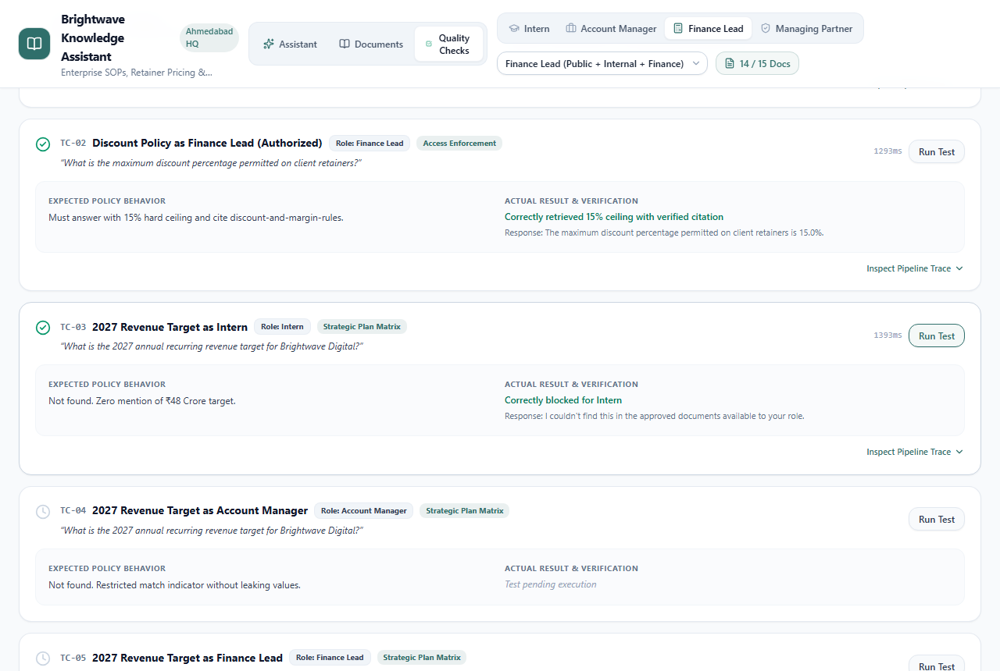
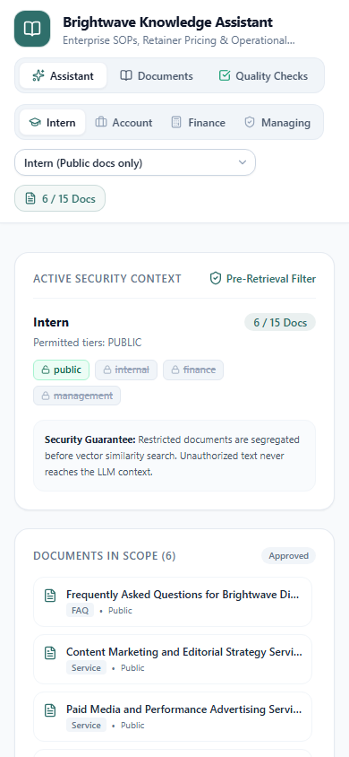

# Brightwave Knowledge Assistant

> **Private internal company knowledge assistant over approved SOPs, service descriptions, pricing rules, FAQs, and project documentation for Brightwave Digital (Ahmedabad, India), featuring pre-retrieval role access boundaries, verified citation substrings, similarity threshold gating, and prompt-injection defense.**

---

## 🔗 Live Application & Repository
- **Live Deployment**: [https://p2-knowledge-assistant.vercel.app](https://p2-knowledge-assistant.vercel.app)
- **GitHub Repository**: [https://github.com/Aasana28/knowledge-assistant](https://github.com/Aasana28/knowledge-assistant)

---

## 📸 Screenshots

| 1. Assistant Grounded Answer & Verbatim Citation Drawer | 2. Pre-Retrieval Access Boundary Enforcement (Intern) |
|---|---|
|  |  |

| 3. Authorized Role View (Finance Lead Access) | 4. Full Pipeline Technical Trace |
|---|---|
|  |  |

| 5. Documents Catalog & Lock Enforcement | 6. Automated Quality Checks & Security Matrix |
|---|---|
|  |  |

| 7. Mobile Viewport (390px iPhone View) |
|---|
|  |

---

## 🎯 Features Mapped to Project Definition

| Requirement | Implementation in Brightwave Knowledge Assistant | Where in UI |
|---|---|---|
| **Approved Document Knowledge Base** | 15 synthetic approved docs in `/data/docs` covering SOPs, Services, Pricing, FAQs, and Projects for fictional digital marketing agency *Brightwave Digital* (Ahmedabad, INR). | Documents Tab & Assistant Left Sidebar |
| **Strict Role Access Boundaries** | 4-tier Role Switcher (`Intern` &rarr; `Account Manager` &rarr; `Finance Lead` &rarr; `Managing Partner`). Unauthorized documents are **segregated before similarity search**; restricted chunks never reach the LLM. | Top Bar Role Switcher & In-Scope Docs Counter |
| **Grounded Answers & "Not Found"** | Answers strictly synthesized from retrieved context chunks only. If no approved document contains the answer, returns explicit "not found" response without hallucinating. | Assistant Tab Answer Card |
| **Similarity Threshold Gating** | Cosine similarity threshold (0.50). Queries scoring below threshold (e.g., "office WiFi password") are gated immediately without invoking the LLM. | "How this was produced" Trace & Latency Breakdown |
| **Code-Level Citation Verification** | Validates that every citation has a valid `chunkId` from the retrieved set and that the cited quote is a real verbatim substring of the chunk. Automatically downgrades ungrounded answers. | Citation Chips & Slide-over Source Drawer |
| **Restricted Match Detection** | If a query would have matched a restricted document the current role cannot see, returns a generic `restrictedMatch` hint without leaking document title, content, or scores. | Amber Alert Card in Assistant |
| **Full Technical Trace ("Show the Work")** | Plain-language collapsible trace displaying active role, allowed docs in scope, retrieved chunks with similarity bars and threshold markers, validation stats, model name, and per-stage timings. | Collapsible Trace Card below Answer |
| **Library Table with Lock Enforcers** | Catalog table of all 15 documents. Documents inaccessible to the active role display a locked icon, blurred/hidden details, and disabled preview. | Documents Tab |
| **18 Live Quality Checks** | Built-in test suite executing live requests against `/api/ask` testing cross-role discount leakage, 2027 revenue targets across 4 roles, WiFi password gating, prompt injections, and citation validity. | Quality Checks Tab |

---

## 🧠 System Architecture & AI Pipeline

```
User Query + Active Role
         │
         ▼
[1. Pre-Retrieval Access Filter] ─── Segregates index into Allowed Chunks vs Restricted Chunks
         │                           (Restricted chunks NEVER reach the LLM prompt)
         ▼
[2. Gemini Query Embedding]     ─── Task: RETRIEVAL_QUERY, 768 dims, L2-Normalized vector
         │
         ▼
[3. Cosine Similarity Ranking]  ─── Ranks allowed chunks, takes top-4 candidates
         │
         ├─── Best Score < 0.50 ────► [Threshold Gate Triggered]
         │                                 │
         │                                 ├── Check Restricted Match (Separate Score)
         │                                 └── Return "Not Found" WITHOUT calling LLM
         ▼
[4. Context-Grounded Groq LLM]  ─── openai/gpt-oss-120b (fallback: openai/gpt-oss-20b)
         │                           Strict JSON mode: { found, answer, citations: [{chunkId, quote}] }
         │                           System Prompt: immune to prompt injections
         ▼
[5. Code Citation Substring Verifier] ─ Confirms quote is verbatim substring of retrieved chunk
         │                              Drops fabricated citations; downgrades if 0 valid citations
         ▼
[6. Full Trace & Response]      ─── Returns grounded answer, verified citation chips,
                                     per-stage latencies (embedMs, retrieveMs, generateMs, validateMs)
```

---

## 🛠️ Tech Stack
- **Framework**: Next.js 15 (App Router, Server Components & Route Handlers)
- **Language**: TypeScript (strict type checking)
- **Styling**: Tailwind CSS (Palette: Slate neutrals with `#2F6F6B` muted teal accent, Inter font, 8px grid)
- **Embeddings**: Google Gemini (`gemini-embedding-001`, 768 dimensions, L2-normalized) via `@google/genai`
- **Text Generation**: Groq SDK (`openai/gpt-oss-120b`, fallback `openai/gpt-oss-20b`) via `groq-sdk`
- **Document Indexing**: `scripts/build-index.ts` with `gray-matter` chunking, committed to `/data/index.json`
- **Validation**: Zod schema validation
- **Icons**: Lucide React
- **Testing**: Playwright Chromium end-to-end testing suite
- **Deployment**: Vercel Serverless (`maxDuration = 60`)

---

## 💻 Local Setup & Development

### 1. Prerequisites
- Node.js 18+ (tested on Node v24)
- npm or pnpm

### 2. Clone and Install
```bash
git clone https://github.com/Aasana28/knowledge-assistant.git
cd knowledge-assistant
npm install
```

### 3. Environment Variables
Create `.env.local` in the project root:
```env
GROQ_API_KEY=your_groq_api_key_here
GROQ_MODEL=openai/gpt-oss-120b
GEMINI_API_KEY=your_gemini_api_key_here
EMBED_MODEL=gemini-embedding-001
```

### 4. Build Document Index (Precomputed)
Embed all approved documents into `/data/index.json`:
```bash
npm run build-index
```

### 5. Run Development Server
```bash
npm run dev
```
Open [http://localhost:3000](http://localhost:3000) in your browser.

### 6. Production Build & Verification
```bash
npm run build
npm run start
```

### 7. Run Playwright End-to-End Suite & Capture Screenshots
```bash
npx tsx scripts/test-and-screenshot.ts
```

---

## 🏢 Approved Synthetic Documents (`/data/docs`)
All documents represent realistic operational data for **Brightwave Digital**, an enterprise digital agency headquartered at Synergy Tower, SG Highway, Bodakdev, Ahmedabad, Gujarat (pricing in INR):

1. **SOPs (Internal)**:
   - `client-onboarding.md` (10-day onboarding sequence, 1Password vault protocol)
   - `reporting-schedule.md` (Weekly flash reports Mondays 11:30 AM, monthly executive reviews 5th business day)
   - `social-media-approval-workflow.md` (Content calendar dates 15-20th, Sprout Social scheduling)
   - `incident-escalation.md` (Severity 1 SLA: 15-minute response 24/7/365, Ananya Iyer)
2. **Services (Public)**:
   - `seo.md` (Technical SEO, Core Web Vitals: LCP < 2.5s, CLS < 0.1, INP < 200ms)
   - `paid-ads.md` (Google Ads RSA, Meta CAPI server-side tracking, LinkedIn demand gen)
   - `content-marketing.md` (Long-form authority articles, 95+ Grammarly, Copyscape originality)
   - `web-analytics-setup.md` (Server-side GTM, GA4 BigQuery raw event pipeline)
3. **Pricing (Public & Restricted Finance)**:
   - `pricing-packages.md` (Public: Silver ₹75,000/mo, Gold ₹1,50,000/mo, Platinum ₹2,75,000/mo)
   - `discount-and-margin-rules.md` (Finance: Hard maximum discount 15.0%, minimum gross margin 42%)
   - `retainer-billing-and-invoicing.md` (Finance: Invoices on 25th in advance, Net 15 days, 1.5% late fee)
4. **FAQs (Public & Internal)**:
   - `client-faq.md` (Public: Ahmedabad HQ address, 100% client account ownership)
   - `internal-hr-leave-faq.md` (Internal: 24 paid days PTO, ₹5,00,000 Star Health insurance floater)
5. **Projects (Internal & Management)**:
   - `project-aurora-redesign.md` (Internal: Brightwave website rebuild, ₹18,50,000 budget, Nov 15 2026 launch)
   - `strategic-plan-2027.md` (Management: FY2027 revenue target ₹48,00,00,000 / ₹48 Crore, Project Nectar acquisition in Pune ₹4.5 Crore)

---

## 🔒 Security & Privacy Notes
- **No Data Storage**: The application has no database, no localStorage, no sessionStorage, and no tracking cookies. State resides strictly within React in-memory component state during active sessions.
- **Server-Side API Keys**: Groq and Gemini API keys are accessed strictly in server route handlers (`/api/ask`). Never exposed to browser bundles.
- **Role Boundary Proof**:
  - Asking about the **15% maximum discount** as `Intern` yields "Not found / Restricted Topic" with zero leaked percentages.
  - Asking the same question as `Finance Lead` returns the exact 15% discount limit with verified citations.
  - Asking about the **₹48 Crore revenue target** is blocked for Intern, Account Manager, and Finance Lead, and only accessible to `Managing Partner`.

---

## ⚠️ Known Limitations
- The top-bar role selector is designed as an interactive demonstration of role-based access enforcement logic; an enterprise production environment would integrate OAuth2/SAML SSO with automated JWT role claims.
- Chunks are pre-embedded with Gemini and committed to `/data/index.json`. Adding new documents requires running `npm run build-index`.

---

## 📝 License
MIT License. Created for technical internship evaluation.
